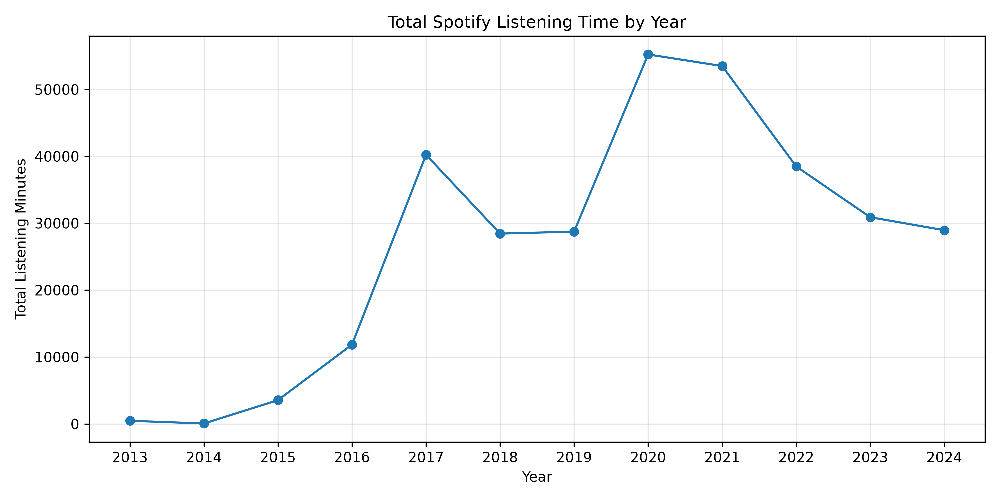
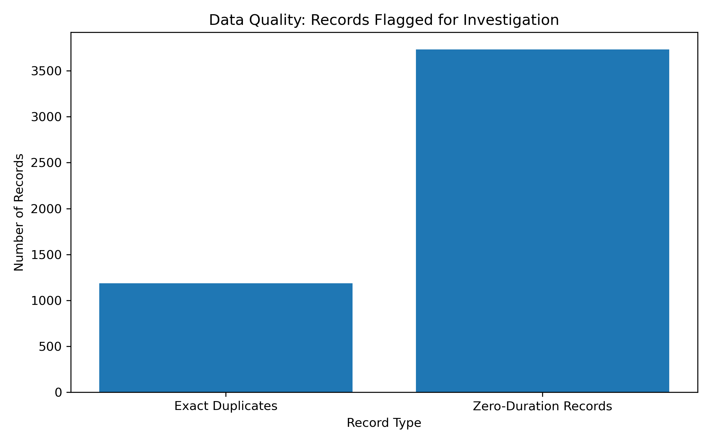

# spotify-streaming-data (analysis)

## project overview

Exploring personal Spotify streaming history to identify listening habits, behavioral patterns, and trends over time. Using data analytics and statistical methods, the project aims to uncover insights into music preferences, listening behavior, and how these patterns can change over time.

## some objectives

- Analyze listening habits over time.
- Identify favorite artists, tracks, and albums based on listening behavior.
- Explore listening patterns by hour, day, month, and year.
- Investigate song skipping and listening duration.
- Examine repeat listening behavior and music preference trends.
- Develop visualizations to communicate findings.

## visualizations from eda 

### annual listening minutes

### average daily listening

### weekday vs. weekend listening

### data quality

## tools

- Python
- Pandas
- NumPy
- Matplotlib / Seaborn
- SQL
- Power BI (planned)

## workflow/ timeline

1. Data collection
2. Data cleaning and preparation
3. Exploratory data analysis
4. Statistical analysis
5. Data visualization
6. Dashboard development
7. Findings and conclusions
