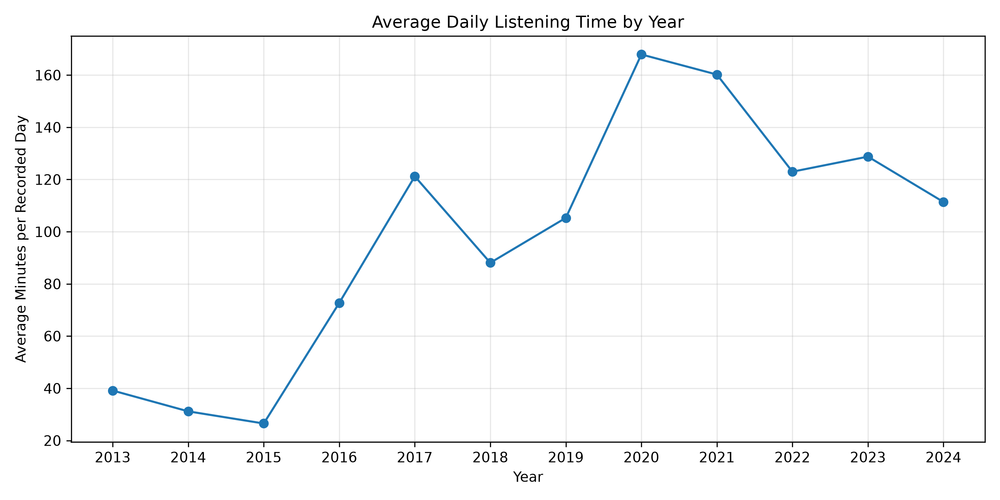
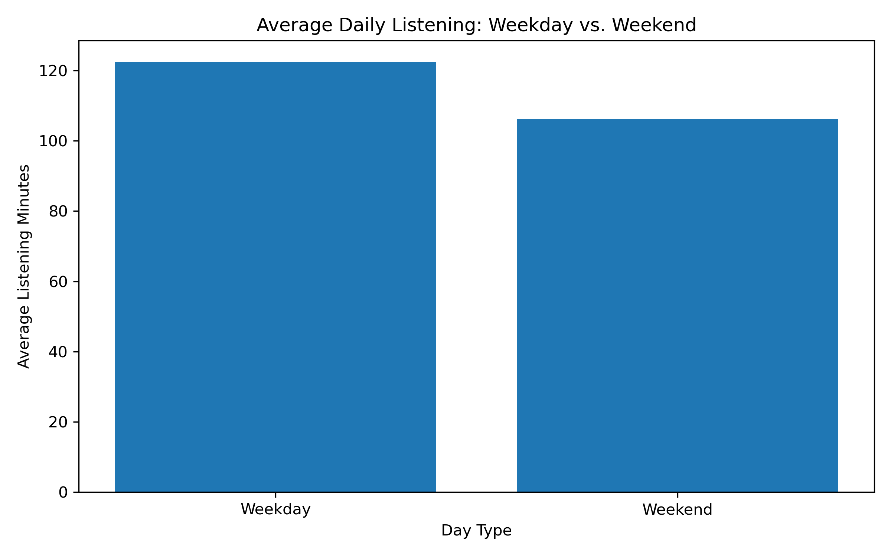
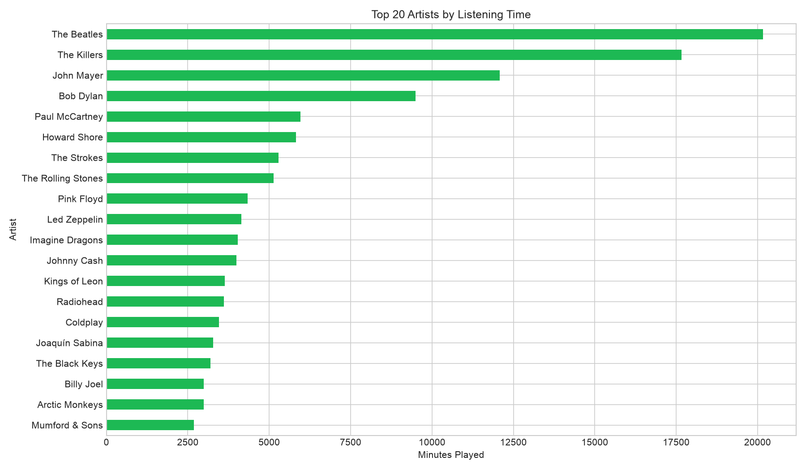
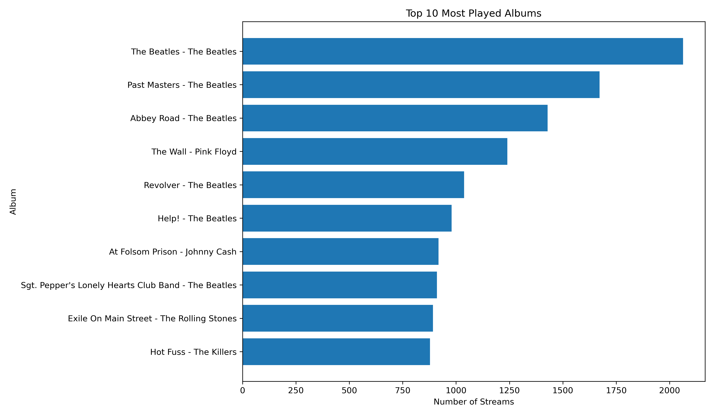

# spotify-streaming-data (analysis)

## project overview

Exploring personal Spotify streaming history to identify listening habits, behavioral patterns, and trends over time. Using data analytics and statistical methods, the project aims to uncover insights into music preferences, listening behavior, and how these patterns can change over time.

## some objectives

1. Analyze listening habits over time.
2. Identify favorite artists, tracks, and albums based on listening behavior.
3. Explore listening patterns by hour, day, month, and year.
4. Investigate song skipping and listening duration.
5. Examine repeat listening behavior and music preference trends.
6. Develop visualizations to communicate findings.

## visualizations from eda (obj. 1)

### annual listening minutes

Compares average listening time and streams per active day across years, providing insight into changes in daily listening habits.

### average daily listening

Examines differences in listening behavior between weekdays and weekends, comparing average streams and listening minutes per active day.

### weekday vs. weekend listening

Examines differences in listening behavior between weekdays and weekends, comparing average streams and listening minutes per active day.

### data quality

Summarizes potential data quality issues, including duplicate records, zero-duration streams, and missing values, to assess data reliability before analysis.

## listening preferences (obj. 2)

Identifying favorite artists, tracks, and albums by measuring listening frequency across the streaming history. Rankings are based on the number of recorded streams for each music entry.

<table>
  <tr>
    <td align="center" width="50%">
      <h3>Top Artists</h3>
      
Ranks artists by total recorded streams to identify the artists most frequently listened to throughout the dataset.

      
    </td>
    <td align="center" width="50%">
      <h3>Top Tracks</h3>
      
Identifies the most frequently played individual tracks, highlighting songs with the highest listening frequency.

      
    </td>
  </tr>
  <tr>
    <td align="center" width="50%">
      <h3>Top Albums</h3>
      
Ranks albums based on listening activity to reveal which albums received the most engagement over the recorded listening history.

      
    </td>
    <td align="center" width="50%">
    </td>
  </tr>
</table>

## tools

- Python
- Pandas
- NumPy
- Matplotlib / Seaborn
- SQL
- Power BI (planned)

## workflow/ timeline

1. Data collection
2. Data cleaning and preparation
3. Exploratory data analysis
4. Statistical analysis
5. Data visualization
6. Dashboard development
7. Findings and conclusions
